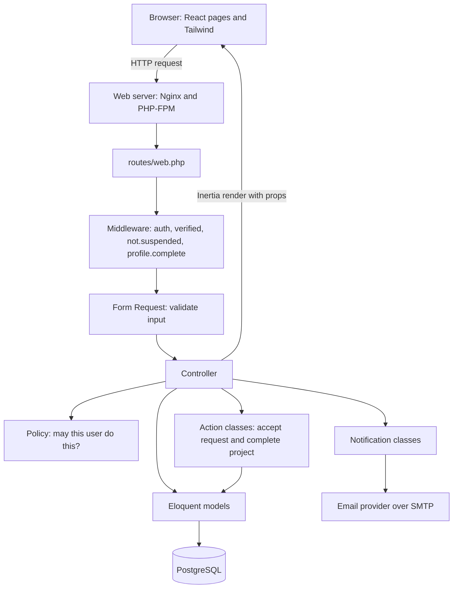
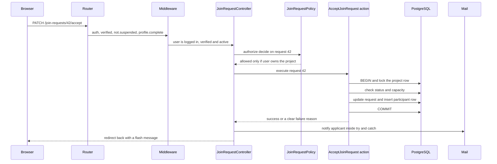
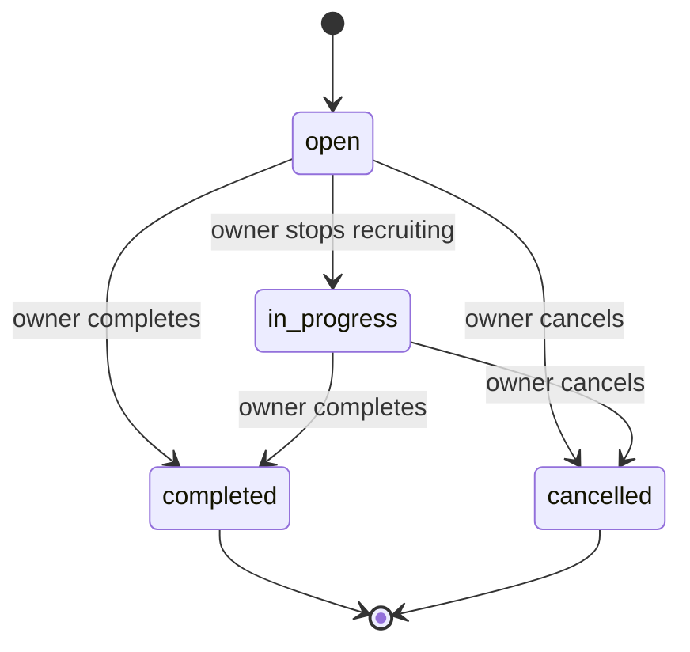
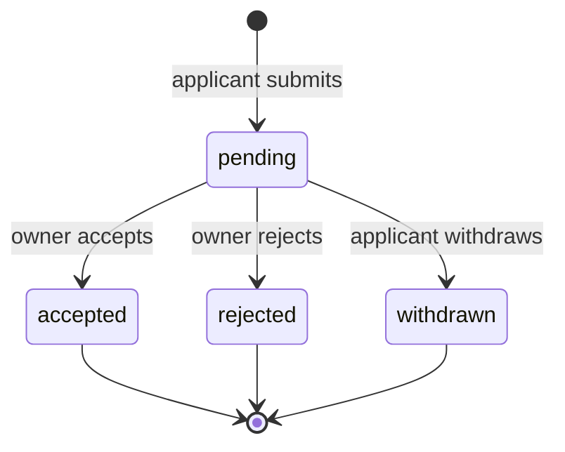
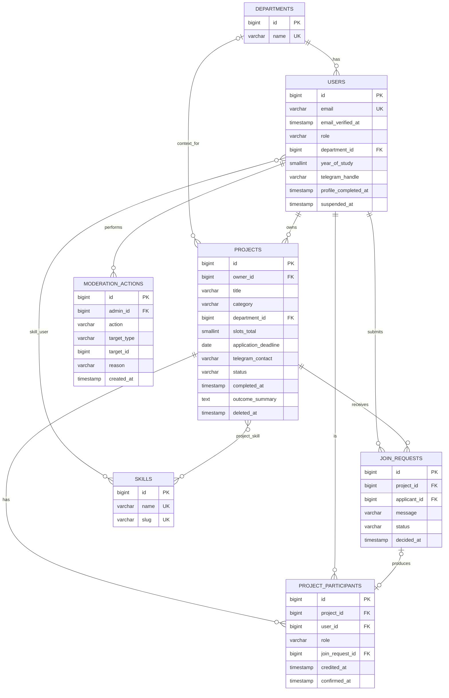

# ProjectNode Blueprint — File 02: System Architecture and Database Design

*Version 1.1. Mermaid diagrams render on GitHub, GitLab, VS Code (with a Mermaid extension) and https://mermaid.live.*

## 2.1 Major system components

ProjectNode is a classic **monolith**: one Laravel application that renders React pages through Inertia and talks to one PostgreSQL database. There is no separate API server, no message broker and no cache server. For a 14-day MVP this is deliberate: every extra moving part is something you must deploy, secure and debug.



| Component | What it is | Why it exists |
|---|---|---|
| Laravel app | PHP code: routing, validation, permissions, database access | Holds **all** rules. The browser is untrusted. |
| Inertia.js | A thin adapter that lets Laravel controllers return React pages with data (props) instead of HTML or JSON | Gives a React interface without building a separate API, handling tokens, or configuring CORS. Login stays a normal session cookie. |
| React + Tailwind | Presentation only | Renders what the server decided to send. |
| PostgreSQL | Relational database | Enforces integrity with constraints that no bug in PHP can bypass. |
| SMTP provider | External mail service | Sends verification and notification emails. |
| Sessions (database) | Server-side login state stored in a `sessions` table | Lets you terminate a suspended user's sessions. |

## 2.2 How a request travels through the application

**Worked example:** the project owner clicks "Accept" on a join request.



Step by step:

1. **Router** matches the URL and HTTP verb, and loads the `JoinRequest` model by id (route-model binding). A missing id produces a 404 automatically.
2. **Middleware** runs first. `auth` checks the session (are you logged in?). `verified` checks `email_verified_at`. `not.suspended` and `profile.complete` are small custom middleware.
3. **Controller** receives the request. It calls `$this->authorize('decide', $joinRequest)`, which runs the policy.
4. **Policy** answers one question: may this user perform this action on this record? A "no" becomes an HTTP 403.
5. **Action class** performs the multi-step database work inside a transaction.
6. **Controller** sends the notification and returns an Inertia redirect. Validation failures never reach this point: Form Requests validate before the controller body runs, and failed validation returns the user to the form with error messages.

## 2.3 Responsibility of each layer

| Layer | Responsibility | Example in ProjectNode | Should **not** contain |
|---|---|---|---|
| **Routes** (`routes/web.php`) | Map URLs to controllers and attach middleware groups | `Route::patch('/join-requests/{joinRequest}/accept', ...)` | Logic or queries |
| **Middleware** | Checks that apply to groups of routes before the controller | `verified`, `not.suspended`, `profile.complete` | Per-record permissions |
| **Form Requests** | Validate and normalize input; may also authorize | `StoreProjectRequest`, `UpdateProfileRequest` | Database writes |
| **Controllers** | Coordinate: authorize, call model or action, return response | `ProjectController@store` | Long business logic, raw SQL |
| **Policies** | Per-record permission rules | `ProjectPolicy::update` | Anything that changes data |
| **Models** (Eloquent) | Table representation, relationships, casts, **query scopes**, small domain helpers | `Project::scopeRecruiting`, `Project::isRecruiting()` | HTTP concerns |
| **Actions** (plain classes in `app/Actions`) | One multi-step transactional workflow | `AcceptJoinRequest`, `CompleteProject` | Anything simple enough for a controller |
| **Notifications** | Build and send an email | `JoinRequestReceived`, `JoinRequestDecided` | Business rules |
| **Migrations** | Version-controlled schema changes | `create_projects_table` | Seed data (use seeders) |
| **Seeders and factories** | Departments, skills, demo data | `DepartmentSeeder`, `SkillSeeder` | Production secrets |
| **React pages** | Display data, forms, client-side convenience | `Projects/Index.jsx` | Security decisions |

**Why only two Action classes?** A "service layer" for everything is the classic overengineering trap. Accepting a request and completing a project each involve several writes that must succeed or fail together plus locking, which is awkward to read inside a controller and easy to test in isolation. Everything else stays in controllers and models.

**Why Inertia changes how you think about security.** Whatever you pass to `Inertia::render('Page', [...props])` is serialized into the page and visible to the user in browser dev tools, even if your React code never displays it. Therefore never pass a whole `User` or `Project` model carelessly. Select the fields you intend to expose (explicit `select`, or an API Resource class) and decide server-side whether the Telegram contact is included.

## 2.4 Database tables

Conventions: `id` is `bigint` auto-increment primary key (Laravel `id()`); `timestamps` means `created_at` and `updated_at`. Statuses are stored as short `varchar` columns backed by **PHP enums** in code and **CHECK constraints** in the database (added with `DB::statement('ALTER TABLE ... ADD CONSTRAINT ... CHECK (...)')` inside the migration, because Laravel's schema builder has no fluent CHECK). Varchar plus CHECK is preferred over native PostgreSQL ENUM types because adding a status later is a one-line constraint change rather than an awkward type migration.

**Time zone note.** With `APP_TIMEZONE=Africa/Addis_Ababa`, Laravel stores timestamps in local time. Ethiopia has no daylight saving, so there is no ambiguity, and "today" in your queries means today in Addis Ababa.

**Table purposes at a glance**

| Table | Why it exists | Needed now? |
|---|---|---|
| `users` | Accounts, profile, role, suspension. One table, because the profile is one-to-one with the account and splitting adds a join to every page for no benefit. | Yes |
| `departments` | Controlled list for profile and filtering; keeps data consistent | Yes |
| `skills` | Controlled vocabulary for skills; makes skill filtering reliable | Yes |
| `skill_user` | Many-to-many: users to skills | Yes |
| `projects` | The listing, its status, and its completion outcome | Yes |
| `project_skill` | Many-to-many: projects to required skills | Yes |
| `join_requests` | The **application workflow** (message, status). A request is a conversation between applicant and owner; it ends. | Yes |
| `project_participants` | The **membership fact**: who is on a project, in what role, and whether they were credited and confirmed. Outlives the application. | Yes |
| `moderation_actions` | Audit log of admin actions | Yes (small) |
| `sessions`, `password_reset_tokens` | Laravel framework tables created by default migrations | Yes (framework) |
| `endorsements` | **Not created.** See 2.7. | No |

### `users`

| Column | Type | Constraints and notes |
|---|---|---|
| id | bigint | PK |
| name | varchar(100) | NOT NULL |
| email | varchar(255) | NOT NULL, UNIQUE. Stored lowercase and trimmed. |
| email_verified_at | timestamp | NULL until verified |
| password | varchar(255) | NOT NULL (hash) |
| remember_token | varchar(100) | NULL |
| role | varchar(20) | NOT NULL DEFAULT 'student', CHECK in ('student','admin'). Phase 2 adds 'lecturer'. |
| department_id | bigint | NULL, FK departments(id) ON DELETE SET NULL |
| year_of_study | smallint | NULL, CHECK between 1 and 7 |
| bio | varchar(500) | NULL |
| interests | varchar(255) | NULL (display only) |
| telegram_handle | varchar(32) | NULL; stored without the leading @ |
| profile_completed_at | timestamp | NULL; set when all required profile fields are present |
| suspended_at | timestamp | NULL; non-null means suspended |
| suspension_reason | varchar(500) | NULL |
| created_at, updated_at | timestamp | |

Indexes: unique on `email`; index on `department_id`.

### `departments` and `skills`

| Table | Columns |
|---|---|
| departments | id PK; name varchar(150) NOT NULL UNIQUE; timestamps |
| skills | id PK; name varchar(60) NOT NULL UNIQUE; slug varchar(60) NOT NULL UNIQUE; timestamps |

### `skill_user` and `project_skill` (pivot tables)

| Table | Columns | Constraints |
|---|---|---|
| skill_user | user_id, skill_id | Composite PK (user_id, skill_id); FKs ON DELETE CASCADE; index on skill_id |
| project_skill | project_id, skill_id | Composite PK (project_id, skill_id); FKs ON DELETE CASCADE; index on skill_id (this index powers the skill filter) |

### `projects`

| Column | Type | Constraints and notes |
|---|---|---|
| id | bigint | PK |
| owner_id | bigint | NOT NULL, FK users(id) ON DELETE RESTRICT (users are suspended, never hard-deleted) |
| title | varchar(120) | NOT NULL |
| description | text | NOT NULL (validated to 5000 characters) |
| category | varchar(30) | NOT NULL, CHECK in ('personal','hackathon','academic','student_initiative') |
| department_id | bigint | NULL, FK departments(id) ON DELETE SET NULL |
| slots_total | smallint | NOT NULL, CHECK between 1 and 20 |
| hours_per_week | smallint | NOT NULL, CHECK between 1 and 40 |
| duration_weeks | smallint | NOT NULL, CHECK between 1 and 52 |
| application_deadline | date | NOT NULL |
| telegram_contact | varchar(32) | NOT NULL |
| status | varchar(20) | NOT NULL DEFAULT 'open', CHECK in ('open','in_progress','completed','cancelled') |
| completed_at | timestamp | NULL |
| outcome_summary | text | NULL |
| outcome_url | varchar(255) | NULL |
| deleted_at | timestamp | NULL (soft delete: owner deletion or admin removal) |
| created_at, updated_at | timestamp | |

Indexes: `(status, application_deadline)` for the recruiting filter; `(created_at)` for chronological order (add `id` as tie-breaker in the ORDER BY); `category`; `department_id`; `owner_id`.

Why `slots_total` and not a separate `openings` table: see D11 and ADR-7. Why `completed_at`, `outcome_summary` and `outcome_url` live on `projects`: a project completes at most once, so these are plain attributes of the project; a separate table would be a one-to-one table with no benefit.

### `join_requests`

| Column | Type | Constraints and notes |
|---|---|---|
| id | bigint | PK |
| project_id | bigint | NOT NULL, FK projects(id) ON DELETE CASCADE |
| applicant_id | bigint | NOT NULL, FK users(id) ON DELETE RESTRICT |
| message | varchar(500) | NOT NULL |
| status | varchar(20) | NOT NULL DEFAULT 'pending', CHECK in ('pending','accepted','rejected','withdrawn') |
| decided_at | timestamp | NULL |
| created_at, updated_at | timestamp | |

Constraints: **UNIQUE (project_id, applicant_id)** is what actually prevents duplicate requests, even under double-clicks. Indexes: `(applicant_id, status)` for "My applications"; `(project_id, status)` for the owner's inbox.

### `project_participants`

| Column | Type | Constraints and notes |
|---|---|---|
| id | bigint | PK |
| project_id | bigint | NOT NULL, FK projects(id) ON DELETE CASCADE |
| user_id | bigint | NOT NULL, FK users(id) ON DELETE RESTRICT |
| role | varchar(20) | NOT NULL DEFAULT 'member', CHECK in ('owner','member'). Phase 2 may add 'supervisor'. |
| join_request_id | bigint | NULL, UNIQUE, FK join_requests(id) ON DELETE SET NULL. NULL for the owner row. |
| credited_at | timestamp | NULL; set by the owner at completion |
| confirmed_at | timestamp | NULL; set by the participant (and automatically for the owner) |
| created_at, updated_at | timestamp | |

Constraints: **UNIQUE (project_id, user_id)**; index on `user_id` (profile history). A row with role 'owner' is created in the same transaction as the project.

### `moderation_actions`

| Column | Type | Constraints and notes |
|---|---|---|
| id | bigint | PK |
| admin_id | bigint | NOT NULL, FK users(id) |
| action | varchar(40) | NOT NULL ('project_removed', 'user_suspended', 'user_unsuspended') |
| target_type | varchar(20) | NOT NULL ('project' or 'user') |
| target_id | bigint | NOT NULL |
| reason | varchar(500) | NOT NULL |
| created_at | timestamp | NOT NULL |

Index on `(target_type, target_id)`. Two plain columns are used instead of Laravel's polymorphic `morphs()` helper because there are only two target types, and plain columns are easier for a beginner to read and query. There is no foreign key on `target_id` because it points at two tables; that is the accepted trade-off.

## 2.5 Eloquent relationships

| Model | Relationships |
|---|---|
| `User` | `belongsTo(Department)`; `belongsToMany(Skill)`; `hasMany(Project, 'owner_id')` as `ownedProjects`; `hasMany(JoinRequest, 'applicant_id')`; `hasMany(ProjectParticipant)` as `participations` |
| `Department` | `hasMany(User)`; `hasMany(Project)` |
| `Skill` | `belongsToMany(User)`; `belongsToMany(Project)` |
| `Project` | `belongsTo(User, 'owner_id')` as `owner`; `belongsTo(Department)`; `belongsToMany(Skill)`; `hasMany(JoinRequest)`; `hasMany(ProjectParticipant)` as `participants`; `members()` = participants where role is 'member'; uses `SoftDeletes` |
| `JoinRequest` | `belongsTo(Project)`; `belongsTo(User, 'applicant_id')` as `applicant`; `hasOne(ProjectParticipant)` |
| `ProjectParticipant` | `belongsTo(Project)`; `belongsTo(User)`; `belongsTo(JoinRequest)` |
| `ModerationAction` | `belongsTo(User, 'admin_id')` as `admin` |

Cast statuses to enums: `protected $casts = ['status' => ProjectStatus::class];`. Always eager load (`with('owner','skills')`) on list pages to avoid the N+1 query problem, where Laravel runs one extra query per row.

## 2.6 How ownership and statuses are represented

**Ownership.** `projects.owner_id` is the single source of truth. Every owner-only action asks the policy: is `$user->id === $project->owner_id`? The owner also has a participant row (role 'owner') purely so completion and profile history treat everyone uniformly.

**Project status** (stored):



**Join request status** (stored):



**Derived state (not stored).** Whether a project is *currently recruiting* is computed, never saved, so it can never go stale and needs no scheduled job:

```sql
WHERE status = 'open'
  AND application_deadline >= CURRENT_DATE
  AND deleted_at IS NULL
  AND (SELECT COUNT(*) FROM project_participants pp
       WHERE pp.project_id = projects.id AND pp.role = 'member') < slots_total
```

The UI shows a **display label** computed from the same facts: Recruiting, Full, Deadline passed, In progress, Completed, Cancelled. A stored status of 'open' with a past deadline is therefore labelled "Deadline passed" and excluded from the default feed.

**Why not store a `filled_count` column?** A counter can drift out of sync with reality if any code path forgets to update it. Counting participant rows is always correct, and at this scale (at most 20 rows per project) it is instantaneous.

## 2.7 How participation and completion are stored (and what can be trusted)

Separate facts, separate places:

| Fact | Where recorded | Set by | Meaning |
|---|---|---|---|
| Accepted | `join_requests.status = 'accepted'` | Owner | Owner approved this application |
| Recorded participant | A `project_participants` row (role 'member') | System, in the same transaction as acceptance | This student is on the team |
| Credited contributor | `project_participants.credited_at` | Owner, at completion | Owner says this person contributed |
| Confirmed | `project_participants.confirmed_at` | The participant | The participant agrees they took part |
| Project completed | `projects.status = 'completed'`, `completed_at`, `outcome_summary` | Owner | Owner says the project reached an end |

Invariant to protect: *every accepted join request has exactly one member participant row, and vice versa (except owner rows).* Both are written in one transaction inside `AcceptJoinRequest`, so they cannot disagree.

**Why a separate `project_participants` table, and not just status on `join_requests`?** I evaluated both. The separate table is justified by three concrete facts: (1) the owner is a participant but never submits a join request; (2) a join request describes an *application* that ends at the owner's decision, while participation is a lasting *fact* that carries completion data; (3) Phase 2 faculty supervisors can be added as participants without applying. If none of these held, adding two columns to `join_requests` would have been simpler.

**Why no `endorsements` table?** For the MVP it is not justified: the only endorsement the MVP records is the owner's credit plus the participant's confirmation, and both fit in two columns on `project_participants`. A separate table becomes justified only when *third parties* (for example teammates or lecturers) start vouching for specific skills of a specific person on a specific project, because that is a many-to-many relationship with its own data.

**What the MVP can reasonably verify**

- The student controls an `aau.edu.et` mailbox.
- A real application was submitted and the owner accepted it (system-recorded, timestamped).
- The owner stated who contributed, and the person confirmed it (two-party agreement).
- Records are tamper-resistant after completion (frozen by policy, one-time completion).

**What it cannot verify**

- That any work was actually done, or its quality.
- That a listed skill is real. Skills remain self-declared.
- Collusion: two friends can create and complete a fake project together.
- That the person is currently enrolled or is a student rather than staff.

This is why the profile label reads "Owner-reported, confirmed by participant" and why the evidence link is optional context, not a guarantee. Admins can remove fraudulent projects (FR-ADM-02).

**How the listed risks are prevented**

| Risk | Prevention |
|---|---|
| Duplicate completion | Completion runs in a transaction with a row lock on the project; if status is already "completed" it exits without changes (FR-COMP-02). |
| Unauthorized changes to completed projects | `ProjectPolicy::update` returns false when status is completed; participant rows are only modifiable by the confirm action for the participant's own row. |
| False claims of participation | Credits can only reference existing member rows of that project (validated with a scoped `exists` rule); the credit appears on a profile only after the participant confirms it. |
| Accidentally certifying every accepted applicant | The completion form has **no pre-checked boxes**; the owner must tick each contributor. The credited count may be zero (owner only). |

**Does this threaten the 14-day deadline?** Moderately. Estimated cost is about 1.5 days (Day 11). It is classified **Should**. The fallback, if you are behind at Day 10, is to ship "mark as completed" with the outcome summary only, and skip credits, confirmation and profile history. The schema already contains the columns, so nothing needs to be redone.

## 2.8 ER diagram



## 2.9 Normalization

The schema is in **third normal form** where it matters. Plainly: each fact is stored once, in the table that owns it.

- Department names live only in `departments`; users and projects store an id, so renaming a department changes one row.
- Skills are rows, linked through pivot tables, instead of a comma-separated text column, which would be impossible to filter reliably or index.
- The accepted-member count is **derived** rather than stored, avoiding a duplicated fact.
- Deliberate, documented denormalizations: `projects.telegram_contact` (a copy of a handle so a project can use a different contact than the owner's profile), and `moderation_actions.target_type/target_id` (no FK). Both are conscious trade-offs for simplicity.

## 2.10 Future faculty and organization accounts, and Phase 1 versus Phase 2 data

**How faculty and organizations fit later without a redesign.** The MVP already carries three small hooks, costing almost nothing now:

1. `users.role` (a string with a CHECK). A lecturer is simply a `users` row with role `lecturer` and a new nullable `staff_verified_at` timestamp set by an admin (because the email domain alone cannot prove someone is staff). They reuse registration, login, projects and join requests unchanged.
2. `project_participants.role`. A lecturer who supervises a student project is added as role `supervisor` without taking a slot.
3. `projects.owner_id` always points at a user, so a faculty-led project is just a project owned by a lecturer.

For department or organization-led opportunities, Phase 2 adds `organizations` (id, name, type, verified_at) and an `organization_user` pivot (organization_id, user_id, member role), plus a nullable `projects.organization_id`. The project is still owned by a human user; the organization is the sponsoring entity. Nothing existing needs changing, only additions.

What I deliberately did **not** do: a polymorphic `owner_type/owner_id` on projects, an `account_types` table, or per-role profile tables. Those would complicate every query today for a feature that may be designed differently once real lecturers use it.

| Phase 1 (build now) | Phase 2 (wait) |
|---|---|
| users, departments, skills, skill_user, projects, project_skill, join_requests, project_participants, moderation_actions | `organizations`, `organization_user`, `social_accounts` (OAuth account linking), `project_reports`, `notification_preferences`, `endorsements`, `project_roles` (role-specific openings), `interests` taxonomy |
| `users.role` with student and admin | role `lecturer`, `staff_verified_at` |
| `participants.role` owner and member | role `supervisor` |
| Soft delete on projects | Edit history, image path |
