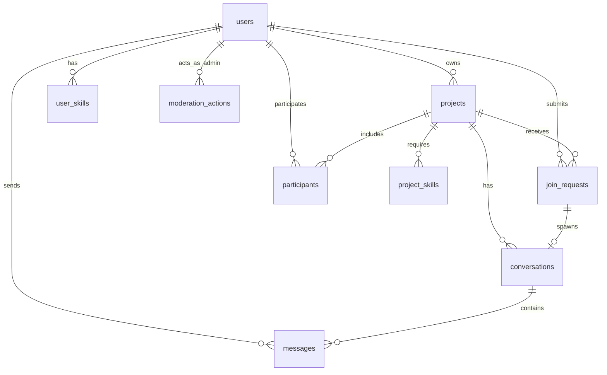

# ProjectNode

<p align="center">
  
  
  
  
  
  
</p>

ProjectNode is an exclusive student project discovery, team assembly, and verified academic credential network engineered specifically for **Addis Ababa University (AAU)**. 

Unlike unstructured messaging boards or transient social chat channels, ProjectNode provides a centralized drafting room where verified student innovators publish project blueprints, recruit multidisciplinary teammates across campus faculties, coordinate privately, and build an immutable, tamper-proof portfolio of real-world engineering work.

---

## 🌟 Key Features

### 🎓 1. Institutional Authentication & Verification
* **University Domain Whitelisting:** Self-registration is strictly restricted to authorized university email domains (e.g. `@aau.edu.et`). Configurable for multi-domain support via `ALLOWED_EMAIL_DOMAINS`.
* **Cryptographically Signed Verification:** Registration automatically dispatches signed verification URLs with 60-minute expiration windows. Tampered or expired links are immediately rejected with HTTP 403.
* **Email Rate Limiting:** Verification resends and password resets are strictly throttled (6 requests per minute) with neutral status reporting.
* **SMTP Diagnostic CLI:** Built-in console utility (`php artisan projectnode:mail-test`) to verify SMTP connectivity, STARTTLS/SSL negotiation, and credential validity before launching in production.

### 👤 2. Student Academic Profiles
* **Academic Metadata:** Department affiliation, year of study (Years 1–7), technical biography, and academic focus areas.
* **Dynamic Technical Skills Matrix:** Searchable combobox picker supporting existing approved campus skills and on-the-fly custom skill creation (up to 3 custom skills per user).
* **Privacy-First Telegram Coordination:** Student Telegram handles are securely collected but **never exposed in public directory feeds or Inertia props**—they are disclosed exclusively to mutual collaborators upon accepted join requests.
* **Profile Completion Gating:** Mandatory profile completion step (enforced via middleware) before students can create projects or submit join requests.

### 🔍 3. Project Discovery & Blueprints
* **Structured Blueprints:** Every project defines required technical skills, weekly time commitment (`hours_per_week`), project duration (`duration_weeks`), maximum openings (`slots_total`), and hard application deadlines.
* **Real-Time Discovery Filters:** Instantly filter campus initiatives by Category (*Software, Hardware, Research, Architecture, Hackathon, etc.*), Academic Department, Remaining Slots, and Application Deadlines (within 7, 14, or 30 days).
* **Live Status & Visual Indicators:**
  * **SlotDots Indicator:** Visual animated indicator showing real-time capacity and slots filled.
  * **DeadlineRing Indicator:** Dynamic circular SVG ring highlighting closing-soon urgency (3 days left, 1 day left, or deadline passed).

### 🤝 4. Application & Collaborator Lifecycle
* **Structured Join Requests:** Students apply with custom notes articulating relevant experience and availability (min 10, max 500 characters).
* **Creator Applicant Inbox:** Project leads inspect applicant profiles, review listed skills, and decide with one-click Accept/Decline actions.
* **Concurrency-Safe Capacity Enforcement:** Acceptance uses PostgreSQL row-level locks (`lockForUpdate()`) and atomic transactions. Slots can never be overfilled even under concurrent clicks.
* **Project State Machine:** Supports transitions across `open` (recruiting), `in_progress` (recruiting paused), `completed` (sealed and credited), and `cancelled` (terminal lock).

### 💬 5. Accepted-Members-Only Real-Time Chat
* **Automatic Channel Provisioning:** Accepting a join request automatically provisions an isolated 1-on-1 conversation channel between the project creator and the accepted applicant.
* **Adaptive Polling Engine:** Real-time polling with exponential backoff on errors and tab focus detection (polls actively on focus, throttles to 30s when backgrounded).
* **Watermark Read Receipts & Chronological Pagination:** Tracks latest read message IDs per participant and supports historical scrollback pagination (`messages.history`).
* **Visual Message Bubbles:** Distinctive sender/counterpart styling—sender messages align to the right labeled *"You"* with dark ink pills, counterpart messages align to the left with their name and clean card containers.

### 🏆 6. Immutable Project Completion & Verified Credits
* **Completion Certification:** Upon project finish, creators submit an outcome summary and an optional evidence deliverable URL (*e.g. GitHub repository, live demo, paper*).
* **Contributor Crediting:** The creator certifies specifically which accepted collaborators made meaningful contributions.
* **Participant Confirmation:** Credited students confirm the credit from their dashboard to seal it permanently onto their public student profile.
* **Permanent Record:** Completed projects freeze all content permanently, creating an immutable technical resume verifiable across campus.

### 🛡️ 7. Campus Moderation & Administrative Suite
* **Role-Based Access Control:** Dedicated administrative dashboard accessible exclusively to authorized `role = admin` accounts.
* **Student Account Moderation:** Administrators can suspend disruptive accounts with a mandatory logged justification. Suspensions take effect immediately, evicting active database sessions and hiding the user's projects from feeds.
* **Project Content Moderation:** Soft-delete and restoration capabilities for projects violating academic policies.
* **Append-Only Audit Trail:** Chronological, immutable moderation log recording timestamp, acting administrator, target entity, action type, and formal justification.

### 🎨 8. Human-Centered Editorial UI Design
* **Warm Luminous Canvas:** Clean, sophisticated `#FAF9F5` backdrop replacing generic SaaS dark voids or template dashboards.
* **Vibrant Editorial Color System:** Warm terracotta (`#B8573D`), soft periwinkle blue (`#6C88EC`), deep forest green (`#0D3B2E`), and royal blue (`#2563EB`).
* **Expressive Typography:** Clean sans-serif (`Plus Jakarta Sans`) paired with display serifs (`Instrument Serif`).
* **Authentic Campus Imagery:** High-resolution local photography (`public/images/`) capturing real university students collaborating, brainstorming, and engineering solutions.

---

## 🛠️ Technology Stack

| Layer | Technologies Used | Description |
|---|---|---|
| **Backend Framework** | **PHP 8.2+**, **Laravel 12.x** | Thin controllers, Form Requests, Model Policies, Eloquent ORM, PHP Backed Enums, Notification mailers. |
| **Frontend Framework** | **React 18**, **Inertia.js 2.x** | SPA feel without API overhead; props passed directly from Laravel controllers without client-side token management. |
| **Styling & Icons** | **Tailwind CSS 3.x**, **Lucide React** | Utility-first responsive design, custom editorial color tokens, accessible SVG icon library. |
| **Interactions & Motion** | **Framer Motion (`motion/react`)**, **Headless UI** | Accessible dialog modals, fluid transition choreography, and animated capacity indicators. |
| **Database** | **PostgreSQL 16** | Relational integrity, `CHECK` constraints, atomic transaction isolation, database-backed session driver. |
| **Asset Bundling** | **Vite 7.x** | Lightning-fast HMR and tree-shaken production builds via `@vitejs/plugin-react` and `laravel-vite-plugin`. |
| **Mail Transport** | **Symfony Mailer / SMTP** | STARTTLS SMTP transport supporting Gmail App Passwords, Brevo, Resend, or institutional relays. |
| **Testing Suite** | **PHPUnit 11.x / Pest** | 134 automated feature and unit tests with complete coverage across security, invariants, and navigation. |

---

## 🏗️ System Architecture & Engineering Principles

```
Browser (React 18 + Inertia.js + Tailwind CSS)
   │
   ▼ HTTP (Session Cookies, CSRF Protection)
Nginx / PHP-FPM
   │
   ▼ routes/web.php
Middleware Pipeline:
   ├─ Authenticate (auth)
   ├─ EnsureEmailIsVerified (verified)
   ├─ EnsureUserNotSuspended (not.suspended)
   └─ EnsureProfileIsComplete (profile.complete)
   │
   ▼ Form Request (Validation & Sanitization)
   │
   ▼ Controller (Thin Orchestration)
   │
   ├── Policy (Authorization: May this student perform this action?)
   ├── Action / Service (Atomic Transactions with lockForUpdate())
   └── Eloquent ORM (PostgreSQL with DB Constraints)
   │
   ▼ Inertia Render (Explicit Resource DTOs — zero sensitive leaks)
Browser React View
```

1. **The Server Holds All Rules:** The browser is strictly an untrusted presentation layer. Every permission check is executed server-side in a Laravel Policy; hiding buttons in React is never the security barrier.
2. **Explicit API Resource Classes:** Data sent to the browser passes through dedicated Laravel API Resources (`MessageResource`, `ProjectResource`). Student email addresses and Telegram handles are never shared in public feeds (NFR-PRIV-01).
3. **Derived Invariants Over Stored Counters:** Slot availability and membership numbers are dynamically computed using `COUNT(*)` queries and subqueries rather than fragile, desynchronized stored counters.
4. **PostgreSQL Check Constraints:** Database migrations enforce business rules at the schema level (e.g. `slots_total >= 1`, non-empty strings, valid enum states).

---

## 📋 Database Schema Overview



* **`users`:** Student identity, university email, role (`student` / `admin`), department, year, bio, encrypted password, suspension status.
* **`projects`:** Title, blueprint description, category, department, capacity limits, weekly hours, deadline, Telegram contact, status (`open`, `in_progress`, `completed`, `cancelled`), outcome details.
* **`skills` & `project_skills` / `user_skills`:** Standardized technical skills taxonomy and many-to-many associations.
* **`join_requests`:** Application pitch notes and status (`pending`, `accepted`, `rejected`, `withdrawn`).
* **`conversations` & `messages`:** Accepted-members-only 1-on-1 private messaging channels and body content.
* **`participants`:** Immutable project team roster, role (`owner` / `member`), certified date, confirmed date.
* **`moderation_actions`:** Append-only audit trail logging administrative interventions and reasons.

---

## 🚀 Getting Started

### Prerequisites
* **PHP:** `^8.2` with `pdo_pgsql`, `mbstring`, `openssl`, `tokenizer`, `xml`, `ctype`, `curl`
* **Composer:** `^2.x`
* **Node.js & npm:** Node `^18.x` or `^20.x` & npm `^9.x`
* **PostgreSQL:** `^15` or `^16`

### 1. Clone & Install Dependencies

```bash
git clone https://github.com/your-username/projectnode.git
cd projectnode

# Install PHP dependencies
composer install

# Install JavaScript dependencies
npm install
```

### 2. Environment Configuration

Copy the example environment file and generate the application encryption key:

```bash
cp .env.example .env
php artisan key:generate
```

Configure your PostgreSQL database connection in `.env`:

```env
DB_CONNECTION=pgsql
DB_HOST=127.0.0.1
DB_PORT=5432
DB_DATABASE=projectnode_dev
DB_USERNAME=your_pg_user
DB_PASSWORD=your_pg_password
```

Configure your application URL (must match the host/port used in your browser for cryptographic verification links to validate):

```env
APP_NAME=ProjectNode
APP_ENV=local
APP_KEY=base64:...
APP_DEBUG=true
APP_URL=http://127.0.0.1:8000
```

### 3. Run Migrations & Seeders

Run the database migrations and populate default AAU departments and common technical skills:

```bash
php artisan migrate --seed
```

### 4. Build Frontend Assets

```bash
# For development with Hot Module Replacement:
npm run dev

# Or build optimized production bundles:
npm run build
```

### 5. Launch the Application

```bash
php artisan serve
```

Visit [`http://127.0.0.1:8000`](http://127.0.0.1:8000) in your browser.

---

## 📧 Email Verification Setup

ProjectNode delivers real email verification messages using standard SMTP.

### Local Development (Gmail SMTP)
1. Enable **2-Step Verification** on your Google Account.
2. Generate an **App Password** (*Google Account > Security > 2-Step Verification > App passwords*).
3. Update your `.env`:

```env
MAIL_MAILER=smtp
MAIL_SCHEME=null
MAIL_HOST=smtp.gmail.com
MAIL_PORT=587
MAIL_USERNAME=your-email@gmail.com
MAIL_PASSWORD=your-16-char-app-password
MAIL_FROM_ADDRESS=your-email@gmail.com
MAIL_FROM_NAME="ProjectNode"

# For local testing with non-AAU addresses (e.g. Gmail):
ALLOWED_EMAIL_DOMAINS=aau.edu.et,gmail.com
```

### Production Email Setup
For production deployments, use a dedicated transactional provider (Resend, Brevo, Postmark, Mailgun):

```env
MAIL_MAILER=smtp
MAIL_SCHEME=null
MAIL_HOST=smtp.provider.com
MAIL_PORT=587
MAIL_USERNAME=your-smtp-username
MAIL_PASSWORD=your-smtp-api-key
MAIL_FROM_ADDRESS="no-reply@aau.edu.et"
MAIL_FROM_NAME="ProjectNode"

# Strict production AAU domain restriction:
ALLOWED_EMAIL_DOMAINS=aau.edu.et
```

> **Important:** Always configure SPF and DKIM DNS records on your sending domain. Institutional university email servers will flag or reject unsigned external mail.

### Diagnostic SMTP Test Command
Verify that your mail server configuration works prior to user testing:

```bash
php artisan projectnode:mail-test your-email@example.com
```

---

## 🧪 Testing Suite

ProjectNode contains an automated test suite comprising **134 passing tests** (862 assertions) covering all critical user flows, security gates, concurrency constraints, and moderation rules.

```bash
# Run the complete test suite:
php artisan test

# Run a specific test group:
php artisan test --filter=ChatTest
php artisan test --filter=ProjectCompletionTest
php artisan test --filter=NavigationSweepTest
```

### Test Coverage Highlights:
* `AdminUserModerationTest`: Verifies immediate session eviction and project suppression upon account suspension.
* `ChatTest`: Asserts atomic 1-on-1 channel creation, concurrency rollback, stranger access blocking (403), and anti-tamper sender ID validation.
* `ProjectCompletionTest`: Verifies creator-only certification, uncredited exclusion, and permanent content freezing.
* `NavigationSweepTest`: Recursively scans all React views to verify that 100% of frontend `route(...)` references match registered Laravel routes.

---

## 🛡️ Security & Privacy Standards

* **NFR-PRIV-01:** Student email addresses and Telegram handles are never shared in public project listings, discovery feeds, or open Inertia responses.
* **Anti-Spoofing:** All action IDs (creator IDs, applicant IDs, sender IDs) are extracted directly from `$request->user()`, never trusted from user input or request parameters.
* **SQL Injection & XSS Protection:** Protected by Eloquent parameterized queries and React automatic HTML escaping (no usage of `dangerouslySetInnerHTML` for user content).

---

## 📄 License

ProjectNode is open-source software licensed under the [MIT License](LICENSE).
